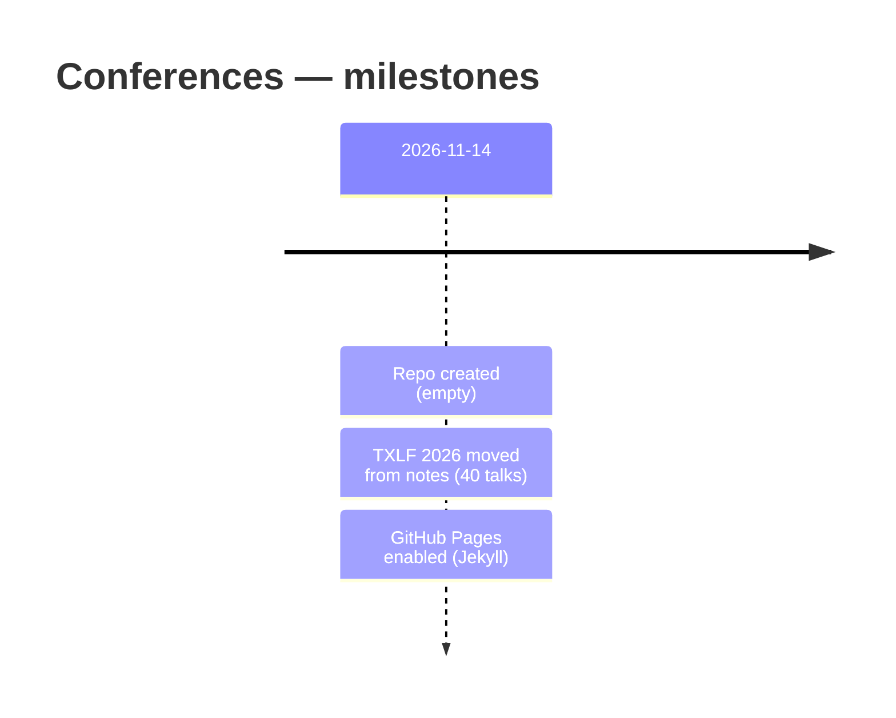
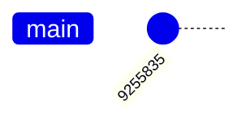

# Conferences

Notes from conferences I attend — talk summaries, links, and repos, organised by event and year.

> This README is the changelog for this repo. Newest first.

## Changelog

### November 16, 2026 — Tux favicon

- **Tux favicon** — the official Linux penguin (Larry Ewing's Tux) now shows in the browser tab, via `favicon.ico` at the repo root and `_includes/head-custom.html` (Midnight's head include, no layout override).
- **Apple touch icon** — `tux-180.png` (180×180) for iOS home-screen bookmarks.

### November 16, 2026 — Landing page redesign

- **Hero header** — new gradient hero with the tagline and a stats chip row (40 talks, Nov 6–7 2026, Austin TX, TXLF 2026).
- **Talk cards** — the Friday and Saturday bullet lists are now card grids (11 + 29 talks), each card with talk number, title, and speaker; the keynote (talk 12) gets a ⭐ Keynote tag. Same talk order and links, nothing moved.
- **No changelog on the Pages site** — the landing page stays changelog-free; this entry lives here in the README only.

### November 14, 2026 — GitHub Pages enabled

- **GitHub Pages** — Jekyll, deploy from `main` / (root), via `_config.yml`. Site: https://chknfrdstk.github.io/Conferences/
- **Theme switched to Midnight (dark, whole site)** — later on Nov 14, from Cayman to `jekyll-theme-midnight`. Slate was tried first, but only its header was dark.
- **Clean Pages home page** — `index.md` (separate from this README) with a card layout for TXLF 2026 and future events, plus the full 40-talk lists. No changelog on the Pages site.
- **Custom dark CSS** — `assets/css/style.scss` overrides Midnight: dark background, accent `#58a6ff`, card grid with hover lift. Same CSS on both sites.
- **Rendered-page links** — talk links now point to the rendered `.html` pages instead of the raw `.md` files, so a talk opens themed instead of as plain white markdown. Links are absolute GitHub Pages URLs, so they work from Forgejo too (opening the rendered page on the public site).
- **Clickable links** — bare URLs in talk/recipe files (YouTube, repos, slides) are now proper markdown links, so they are clickable on GitHub Pages (Pages does not auto-link bare URLs the way Forgejo does).
- **Repeatable setup** — every push to main rebuilds the site automatically. New events go in their own `EVENT/YEAR/` folder with talks + README, push, done. No separate HTML export to maintain.

### November 14, 2026 — Repo created, TXLF 2026 moved from notes

- **Repo created** — empty, then first commit `9255835`.
- **Texas Linux Fest 2026 moved here from notes** — all 40 talk summaries, the index README, and the TXLF logo, copied from `notes/texas-linux-fest-2026/` into `TXLF/2026/`. Moved, not copied — the talks are being removed from notes in a separate change.
- **Counts** — TXLF 2026: 40 talks on YouTube (11 Friday, 29 Saturday), 4 scheduled talks not yet uploaded as of Nov 12, 2026.
- **Future events** — new events go in their own folder by event and year, e.g. `TXLF/2027/`, `SCALE/2027/`.

---

## Contents

### Texas Linux Fest

- [TXLF 2026](TXLF/2026/README.md) — 40 talks, November 6–7, 2026, JJ Pickle Research Campus, Austin, TX.

### Future events

- SCALE and TXLF 2027 go here when they happen, in their own `EVENT/YEAR/` folders.

---

## Workflow

Short-lived branches: make the change, push, merge, delete, move on.
