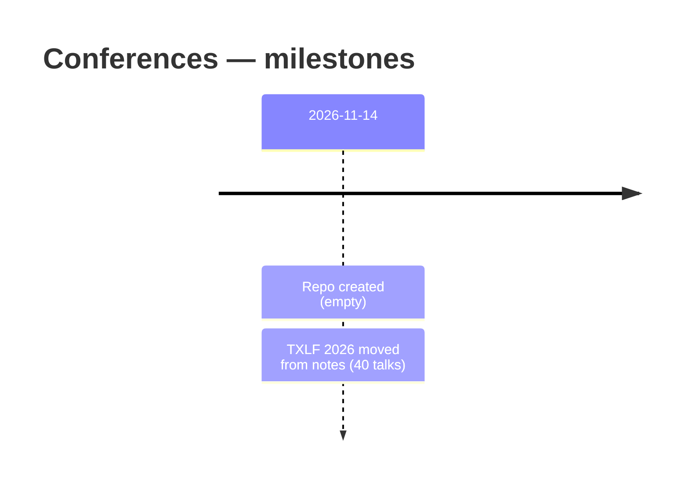
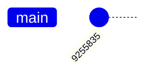

# Conferences

Notes from conferences I attend — talk summaries, links, and repos, organised by event and year.

> This README is the changelog for this repo. Newest first.

## Changelog

### November 14, 2026 — Repo created, TXLF 2026 moved from notes

- **Repo created** — empty, then first commit `9255835`.
- **Texas Linux Fest 2026 moved here from notes** — all 40 talk summaries, the index README, and the TXLF logo, copied from `notes/texas-linux-fest-2026/` into `TXLF/2026/`. Moved, not copied — the talks are being removed from notes in a separate change.
- **Counts** — TXLF 2026: 40 talks on YouTube (11 Friday, 29 Saturday), 4 scheduled talks not yet uploaded as of Nov 12, 2026.
- **Future events** — new events go in their own folder by event and year, e.g. `TXLF/2027/`, `SCALE/2027/`.

---

## Contents

### Texas Linux Fest

- [TXLF 2026](TXLF/2026/README.md) — 40 talks, November 6–7, 2026, JJ Pickle Research Campus, Austin, TX.

### Future events

- SCALE and TXLF 2027 go here when they happen, in their own `EVENT/YEAR/` folders.

---

## Workflow

Short-lived branches: make the change, push, merge, delete, move on.
